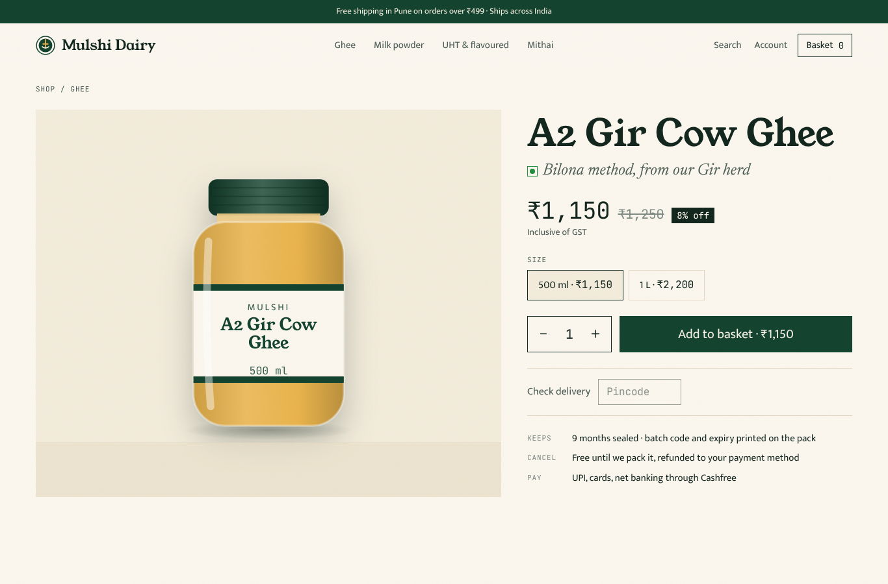
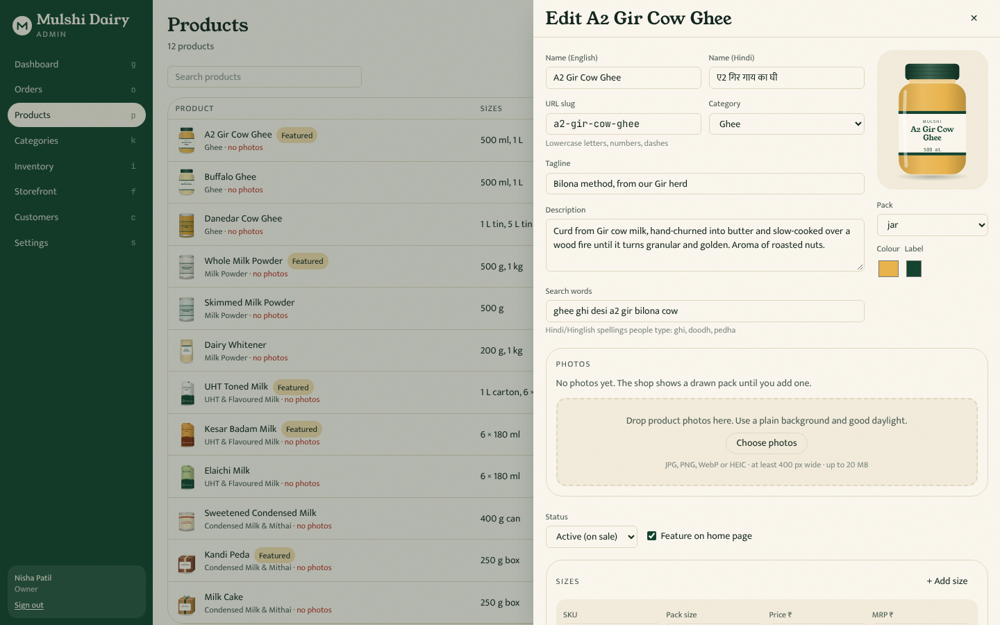
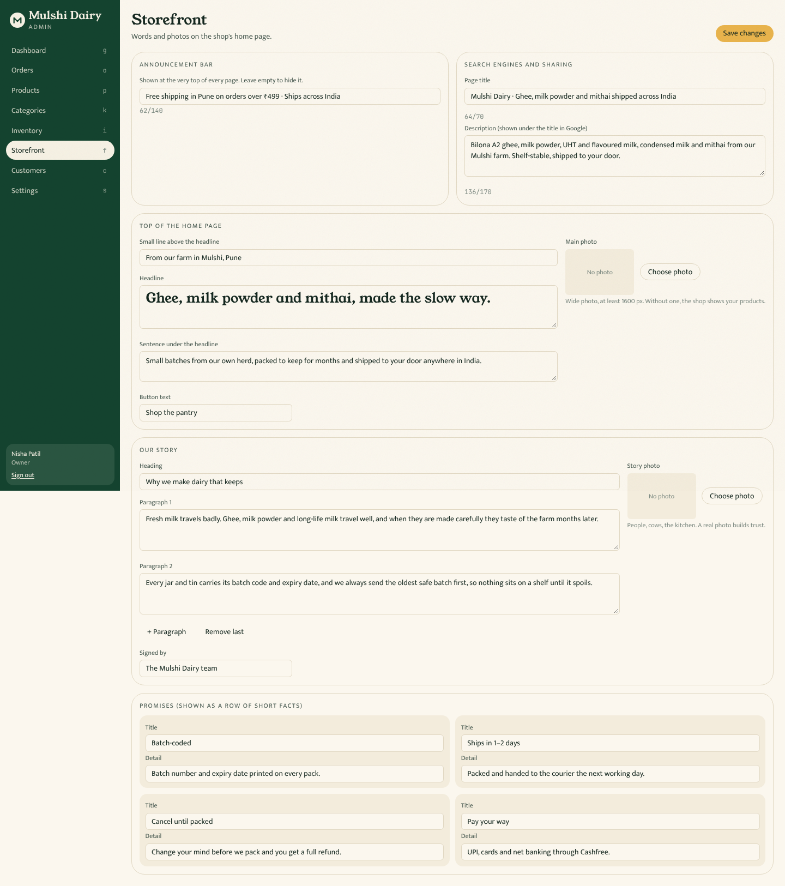
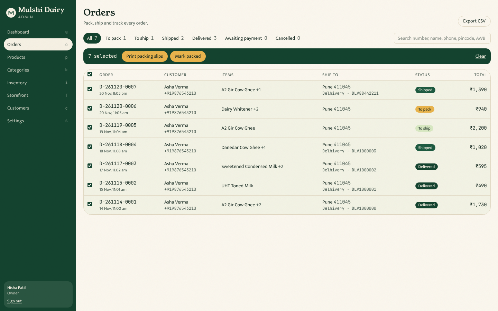

# Mulshi Dairy

Online shop for shelf-stable dairy products (ghee, milk powder, UHT and flavoured milk, condensed milk, mithai), shipped across India, with a full admin panel. One Fastify API serves the storefront, the admin and a future Android app.


| | |
|---|---|
| Roadmap and status | [PLAN.md](PLAN.md) |
| Documentation | [docs/README.md](docs/README.md) |
| API guide · OpenAPI (generated) · rendered reference | [docs/api/README.md](docs/api/README.md) · [openapi.json](docs/api/openapi.json) · [reference.html](docs/api/reference.html) |
| Design system | [docs/08-design-system.md](docs/08-design-system.md) |
| **Launching: keys to provide and setup steps** | [docs/14-go-live.md](docs/14-go-live.md) |

## Repository

```
apps/api      Fastify API + worker (expires unpaid orders, reconciles payments)
apps/web      Next.js storefront (editorial design, Motion, SEO: sitemap, JSON-LD, OG)
apps/admin    Vite + React admin panel
apps/video    Remotion compositions (pantry reel, product reel)
packages/core Business rules: money, IST dates, shipping zones, order states, GST, FEFO stock, pricing
packages/db   Drizzle schema, SQL migrations, seed (12 products, zones, sample orders)
packages/ui   Design tokens, Tailwind theme, PackShot illustrations, shared components
infra/        Docker Compose for app and data servers, Cloudflare Tunnel notes
docs/         Architecture, API, operations, design
```

## Run it locally

Needs Node 22+, pnpm 10 (`corepack enable`), PostgreSQL 16+ and Valkey/Redis (or `docker compose -f infra/compose/dev.yml up -d`).

```bash
pnpm install
cp .env.example .env
# Without Google/Cashfree keys you can still try everything:
#   AUTH_TEST_MODE=true  → "sign in as a test customer" on /signin
#   no CASHFREE keys     → a test payment page stands in for Cashfree checkout
echo "AUTH_TEST_MODE=true" >> .env
pnpm db:migrate && pnpm db:seed
pnpm --filter @dairy/api dev        # http://localhost:4000 (API docs at /docs)
pnpm --filter @dairy/api worker     # expires unpaid orders after 30 minutes
pnpm --filter @dairy/web dev        # http://localhost:3000
pnpm --filter @dairy/admin dev      # http://localhost:5173 (staff sign in with Google)
pnpm --filter @dairy/video studio   # Remotion studio; `render` writes the reel
```

Tests (need a `dairy_test` database; see `apps/api/vitest.config.ts`):

```bash
pnpm --filter @dairy/core test      # 34 unit and property tests
pnpm --filter @dairy/api test       # 35 integration tests on real Postgres: Cashfree webhooks, photo uploads, admin tools
pnpm --filter @dairy/ui contrast    # WCAG contrast for every token pair, light and dark
```

| Product page | Mobile |
|---|---|
|  |  |

| Admin dashboard | Order fulfilment |
|---|---|
|  |  |

| Product editor with photo upload | Storefront editor | Bulk order actions |
|---|---|---|
|  |  |  |
