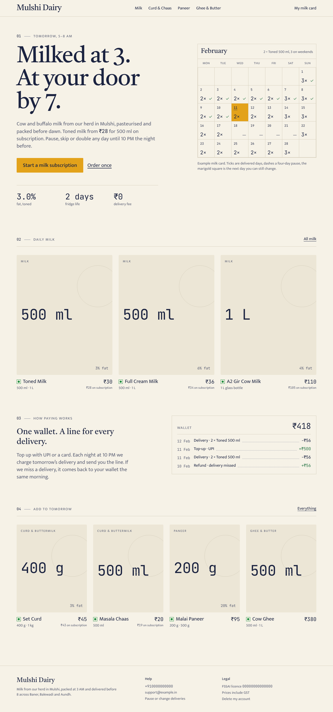

# Mulshi Dairy

Online dairy store for India: daily milk subscriptions, one-time orders, a prepaid wallet with Cashfree payments, delivery operations, and an admin panel. One Fastify API serves the website, the admin, the delivery agent app and a future Android app. Designed to run on free-tier infrastructure (Oracle Cloud Always Free behind Cloudflare).



| | |
|---|---|
| Roadmap | [PLAN.md](PLAN.md) |
| Documentation | [docs/README.md](docs/README.md) |
| API guide and OpenAPI contract | [docs/api/README.md](docs/api/README.md) · [openapi.yaml](docs/api/openapi.yaml) |
| Design system | [docs/08-design-system.md](docs/08-design-system.md) |

## Repository

```
apps/api      Fastify API + background worker (cutoff job)
apps/web      Next.js storefront (customers)
apps/admin    Vite + React admin panel (staff)
packages/core Pure business rules: money, IST cutoffs, subscriptions, wallet ledger, GST, FEFO
packages/db   Drizzle schema, SQL migrations, seed data
packages/ui   "Milk Card" design tokens, Tailwind theme, shared React components
infra/        Docker Compose for the app and data servers, Cloudflare Tunnel notes
docs/         Architecture, API, operations and design documentation
```

## Run it locally

Prerequisites: Node 22+ (24 recommended), pnpm 10 (`corepack enable`), PostgreSQL 16+ with PostGIS, Valkey or Redis.

```bash
pnpm install
cp .env.example .env                      # add GOOGLE_WEB_CLIENT_ID to enable sign-in
docker compose -f infra/compose/dev.yml up -d   # or use your own Postgres + Redis
pnpm db:migrate && pnpm db:seed
pnpm --filter @dairy/api dev              # http://localhost:4000, API docs at /docs
pnpm --filter @dairy/api worker           # runs the nightly cutoff when it's due
pnpm --filter @dairy/web dev              # http://localhost:3000
pnpm --filter @dairy/admin dev            # http://localhost:5173
```

Tests (need a `dairy_test` database; see `apps/api/vitest.config.ts`):

```bash
pnpm --filter @dairy/core test            # 40 unit and property-based tests
pnpm --filter @dairy/api test             # 21 integration tests against real Postgres
pnpm --filter @dairy/ui contrast          # WCAG contrast check for every token pair
```

## Status

| Area | State |
|---|---|
| Documentation, OpenAPI contract, decision records | Done |
| Core business rules (`packages/core`) | Done, tested |
| Database schema, migrations, seed | Done |
| API: Google sign-in, sessions, roles, CSRF, idempotency | Done, tested |
| API: catalog, serviceability, slots, profile, addresses | Done, tested |
| API: subscriptions, pauses, per-day changes, milk-card calendar | Done, tested |
| API: wallet balance, projection, ledger | Done, tested |
| Cutoff job: deliveries, wallet charges, FEFO stock, routes, production plan | Done, tested |
| Storefront: home, catalog, product, sign-in, milk card, onboarding, account deletion | Done |
| Admin: sign-in, dispatch board, production plan | Done |
| Dockerfiles, Compose for app and data servers, CI workflow | Written; Compose files validated; Docker images not yet built in CI |
| Cashfree top-ups, webhooks, one-time orders checkout | Next (Phase 3) |
| Delivery agent app, invoices, notifications, reports, more admin modules | Planned (Phases 5–6) |
| Admin TOTP second factor | Planned |
| Remotion videos | Planned (Phase 7) |
