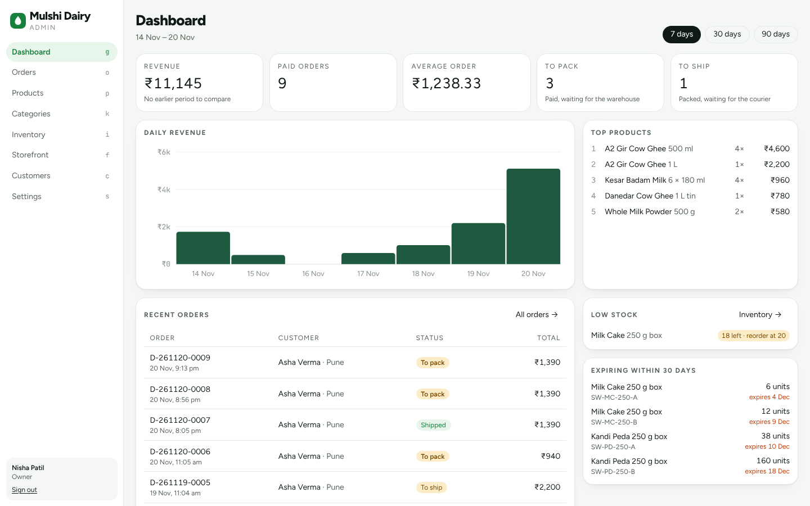
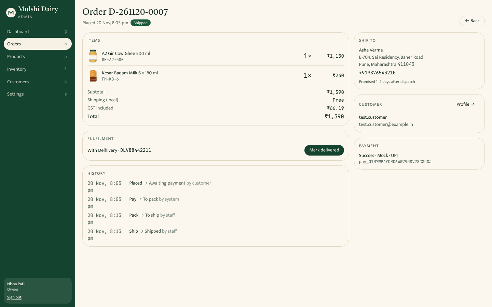

# Mulshi Dairy

Online shop for shelf-stable dairy products (ghee, milk powder, UHT and flavoured milk, condensed milk, mithai), shipped across India by courier, with a full admin panel. One Fastify API serves the storefront, the admin and a future Android app. "Mulshi Dairy" is a placeholder brand name; the owner sets the real one in the admin.


## What it does

- **Shop:** catalogue with pack sizes and unit prices, search, product pages with photo galleries and reviews, basket, coupon codes, pincode delivery check, "use my location" with a map pin for the exact delivery address, checkout, order tracking.
- **Payments:** Cashfree (INR, prepaid only). Sign-in with Google only (no SMS).
- **Admin panel:** products and photos, stock batches, categories, orders (bulk actions, packing slips with a directions QR), coupons, reviews, storefront banners and content, customers and staff roles, dashboard. The owner needs no code.
- **Emails:** order confirmation, shipped, delivered, cancelled and refunded, through Resend or Brevo.
- **For developers:** documented REST API (OpenAPI), strict TypeScript, tested business rules, one-command local setup, one-server deployment with backups.

## Documentation

| I want to…                                                              | Read                                                                                                                                                                                 |
| ----------------------------------------------------------------------- | ------------------------------------------------------------------------------------------------------------------------------------------------------------------------------------ |
| Run it on my computer                                                   | [Quick start](#quick-start) below, then [DEVELOPMENT.md](DEVELOPMENT.md)                                                                                                             |
| Understand how it works                                                 | [ARCHITECTURE.md](ARCHITECTURE.md)                                                                                                                                                   |
| **Put it live on a VPS** (Nginx, HTTPS, backups, updates)               | [DEPLOYMENT.md](DEPLOYMENT.md)                                                                                                                                                       |
| See every setting                                                       | [.env.example](.env.example) (development) · [.env.production.example](.env.production.example) (server)                                                                             |
| Launch checklist: which accounts and keys to get                        | [docs/14-go-live.md](docs/14-go-live.md)                                                                                                                                             |
| Use the API (web, Android)                                              | [docs/api/README.md](docs/api/README.md) · [openapi.json](docs/api/openapi.json) · [reference.html](docs/api/reference.html) · [Android integration](docs/13-android-integration.md) |
| All topic documents (rules, data model, security, design, competitors…) | [docs/README.md](docs/README.md)                                                                                                                                                     |
| Roadmap and status                                                      | [PLAN.md](PLAN.md)                                                                                                                                                                   |

## Quick start

You need **Node 22.12+**, **Docker** (running) and **git**.

```bash
git clone https://github.com/nishant2024-app/ecom.git && cd ecom
./scripts/local-setup.sh you@gmail.com          # Windows: scripts\local-setup.cmd you@gmail.com
pnpm dev
```

The setup script checks your tools, creates `.env`, starts Postgres/Valkey/Mailpit in Docker, installs packages, migrates the database and adds sample products. `pnpm dev` then starts everything (`Ctrl+C` stops it):

| What                                 | Where                      |
| ------------------------------------ | -------------------------- |
| Shop                                 | http://localhost:3000      |
| Admin (sign in with the email above) | http://localhost:5173      |
| API reference                        | http://localhost:4000/docs |
| Caught emails                        | http://localhost:8025      |

While developing, a "test sign-in" replaces Google and a fake payment page replaces Cashfree, so nothing real is charged. Details, troubleshooting and Google Cloud Shell notes: [DEVELOPMENT.md](DEVELOPMENT.md).

## Repository

```
apps/api       Fastify API and background worker
apps/web       Next.js storefront
apps/admin     Vite + React admin panel
apps/video     Remotion promo videos (optional, not part of the running site)
packages/core  Business rules: money, IST dates, shipping zones, order states, GST, FEFO stock, coupons
packages/db    Drizzle schema, SQL migrations, seed
packages/ui    Design tokens, Tailwind theme, fonts, drawn product packs
infra/         Docker Compose (dev and single server), Nginx config, Cloudflare Tunnel notes
scripts/       dev launcher, local setup, deploy, backup, restore
docs/          Topic documentation and the API reference
```

## Common commands

```bash
pnpm dev                 # API + shop + admin        pnpm build       # production build of everything
pnpm test                # unit + API integration    pnpm typecheck   # TypeScript
pnpm lint                # ESLint                    pnpm format:check
pnpm db:migrate          # apply migrations          pnpm db:seed     # seed an empty database
```

CI runs lint, format check, typecheck, tests, the design-contrast check, the OpenAPI freshness check and the production builds on every pull request.

## Screens

| Product page                      | Mobile                                |
| --------------------------------- | ------------------------------------- |
|  |  |

| Admin dashboard                           | Order fulfilment                      |
| ----------------------------------------- | ------------------------------------- |
|  |  |

## Status and known limits

Built and tested end to end in development and automated tests. **Not yet exercised against the real services**: Google sign-in, Cashfree live payments and webhooks, Resend/Brevo email, Docker image builds on a real server, Let's Encrypt. Test each on a staging domain with sandbox keys first ([DEPLOYMENT.md](DEPLOYMENT.md#13-going-live-final-checks)). Courier booking by API, GST invoice PDFs, subscriptions and push notifications are not built yet ([PLAN.md](PLAN.md)). The policy pages (terms, privacy, refunds, shipping) are drafts to be reviewed by your accountant or lawyer.

## Licence and credits

Licence: not yet chosen. Fonts are open source (OFL) and self-hosted; map tiles and address lookup use OpenStreetMap services (light use only; see [docs/16-location-and-delivery.md](docs/16-location-and-delivery.md)). Remotion needs a company licence beyond three people ([docs/09-video.md](docs/09-video.md)).
