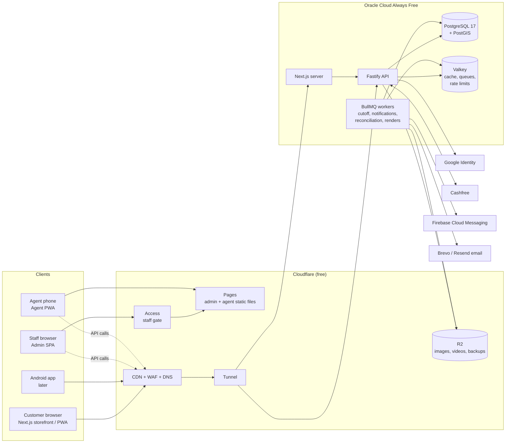
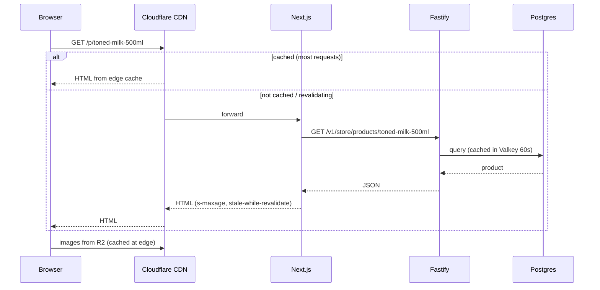
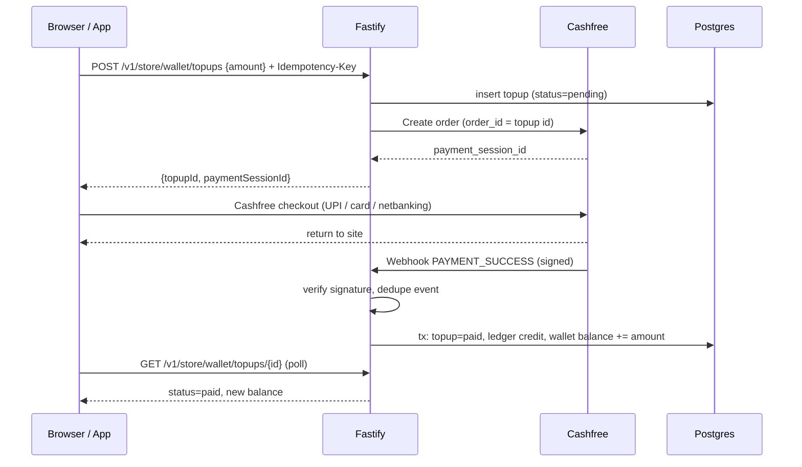
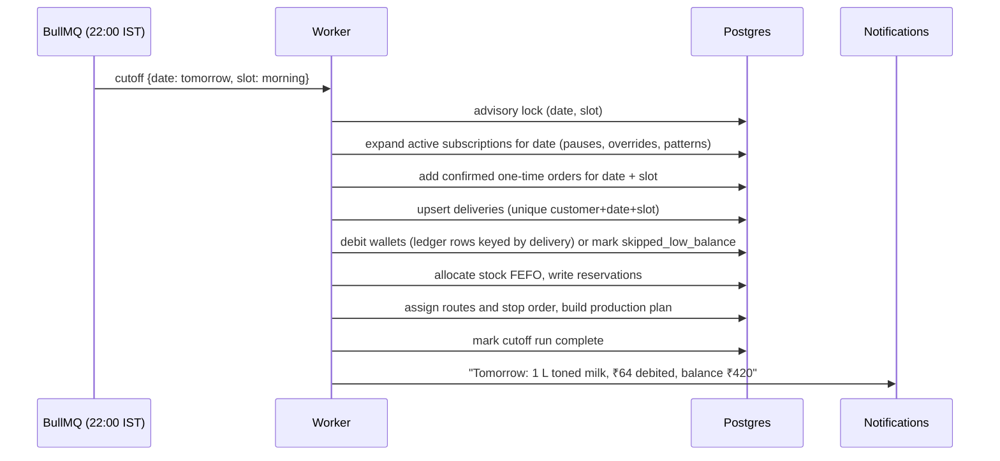
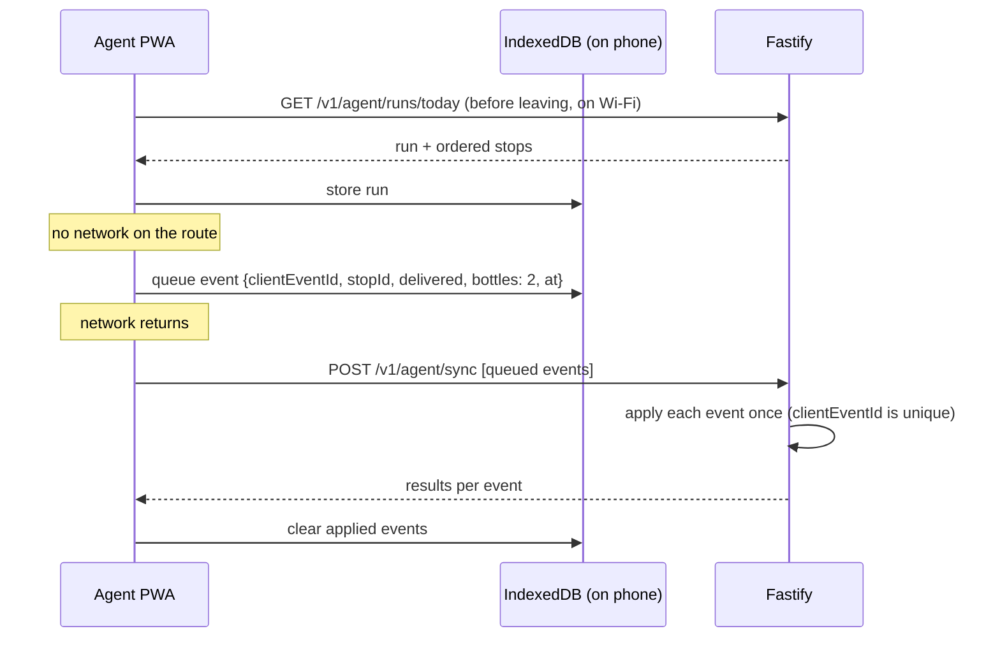

# 02 · Architecture

## System context

## Components

### Fastify API (`apps/api`)

The only component that touches the database. Every client goes through it.

- **Route groups** by audience: `/v1/auth`, `/v1/store`, `/v1/agent`, `/v1/admin`, `/v1/webhooks`. Each group has its own auth hook and permission checks.
- **Schemas first:** each route declares TypeBox request and response schemas. Fastify validates input, serialises output quickly, and `@fastify/swagger` turns the same schemas into the OpenAPI spec.
- **Thin routes:** a route parses input, checks permissions, calls a function in `packages/core` or a service, and returns. Business rules never live in route handlers.
- **Runs as several processes** (Node cluster or multiple containers) behind Cloudflare Tunnel. Stateless: sessions and rate limits live in Valkey and Postgres, so any process can serve any request.
- **Load shedding:** `@fastify/under-pressure` returns `503` with `Retry-After` when the event loop or memory is overloaded, instead of falling over.

### Background workers (`apps/api`, worker entrypoint)

Same codebase, different entrypoint. BullMQ queues on Valkey:

| Queue | Jobs | Schedule |
|---|---|---|
| `cutoff` | Generate deliveries for a date and slot | At each slot's cutoff (repeatable job), plus manual re-run |
| `wallet` | Low-balance checks, autopay charges | After cutoff; on balance change |
| `notifications` | Push, email | On events |
| `payments` | Reconciliation with Cashfree settlements, stale payment checks | Daily 06:00 IST; every 10 min |
| `media` | Image resizing to AVIF/WebP sizes | On upload |
| `video` | Remotion renders | On demand, concurrency 1, low priority |
| `reports` | Heavy CSV exports, monthly statements | Nightly; on demand |
| `maintenance` | Expire carts, clean sessions, restore test trigger | Nightly |

Jobs are idempotent: running one twice must not double-debit, double-notify or duplicate rows. Each job has retry with backoff and a dead-letter queue visible in the admin.

### Storefront (`apps/web`)

Next.js in standalone mode inside Docker on the app VM.

- Catalog, product, category and content pages use **ISR**: rendered once, cached by Cloudflare, revalidated when admin changes the product (the API calls a revalidate endpoint).
- Account, cart, subscription calendar and wallet pages are dynamic and call the API.
- The Next.js server forwards `/api/*` to the Fastify API on the internal network, so browser requests are same-origin. This keeps auth cookies simple and avoids CORS for the storefront.
- PWA: installable, web push, offline page, cached "tomorrow's delivery" view.

### Admin and agent apps (`apps/admin`, `apps/agent`)

Static single-page apps built with Vite, deployed to Cloudflare Pages (free, commercial use allowed). They call `api.example.in` with cookies (see [Authentication](04-authentication.md)). The admin is additionally behind Cloudflare Access.

### Shared packages

| Package | Contents |
|---|---|
| `packages/core` | Pure domain functions: pricing, GST, subscription date expansion, cutoff times, wallet ledger postings, FEFO allocation, state machines. No I/O. Heavily unit-tested. |
| `packages/db` | Drizzle schema, migrations, seed data, query helpers |
| `packages/contracts` | TypeBox schemas shared by API and clients, generated OpenAPI file, generated TypeScript client |
| `packages/ui` | Design tokens, fonts, primitives, the milk-card calendar |
| `packages/emails` | React Email templates |

## Key flows

### 1. Browse a product page

### 2. Sign in with Google

See [Authentication](04-authentication.md#customer-sign-in-flow) for the full sequence.

### 3. Wallet top-up with Cashfree

The browser redirect never marks a payment as paid. Only a verified webhook, or a server-side status check against Cashfree, does. See [Payments](07-payments-cashfree.md).

### 4. Nightly cutoff job

Full rules: [Business rules → Cutoff job](06-business-rules.md#cutoff-job).

### 5. Agent delivery with poor network

## Cross-cutting decisions

| Concern | Decision |
|---|---|
| Time | Store timestamps in UTC (`timestamptz`). Business dates are `date` columns in IST. Cutoffs are computed in `Asia/Kolkata`. |
| Money | Integer paise everywhere: database, API, client. Format only for display. |
| IDs | Prefixed, sortable IDs: `cus_01JD…`, `ord_01JD…` (UUIDv7 encoded). Prefix tells you the type when reading logs. |
| Caching | Cloudflare for public pages and media; Valkey for hot API reads (catalog, zones, settings) with explicit invalidation on admin writes. |
| Consistency | Wallet, stock and order changes happen in one database transaction with row locks. No distributed transactions. |
| Observability | Every request gets a `requestId` (returned in the `X-Request-Id` header and in error bodies). Logs are structured JSON (Pino). |
| Config | 12-factor: everything from environment variables, validated at start-up. The process refuses to start with invalid config. |
