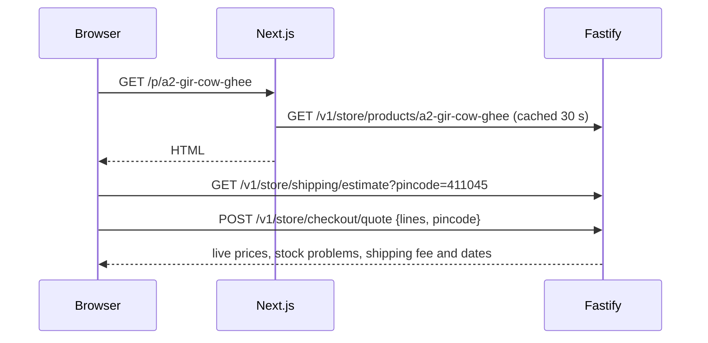
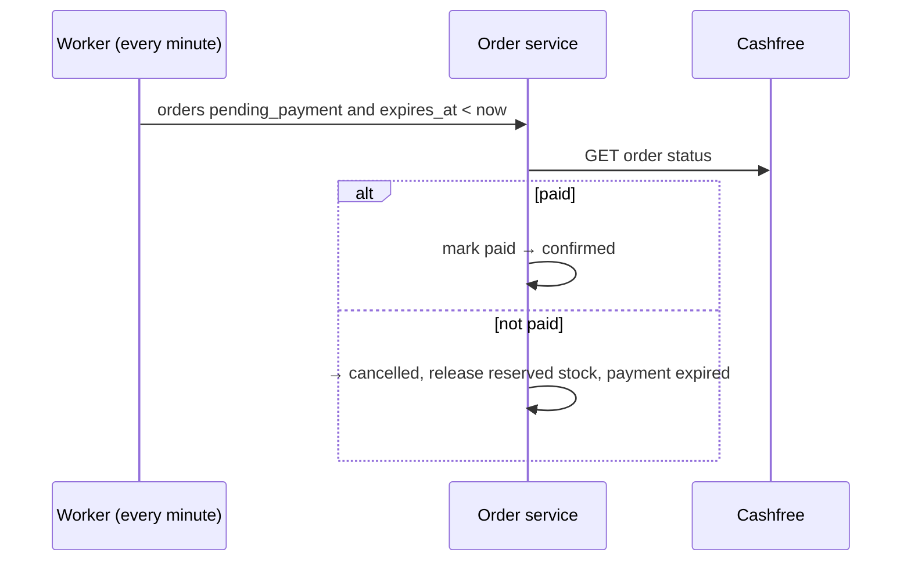

# 02 · Architecture

## System context

```mermaid
flowchart LR
  C[Customer browser<br/>Next.js storefront] --> CF
  A[Android app<br/>later] --> CF
  S[Staff browser<br/>Admin SPA] --> ACC
  subgraph CF[Cloudflare free]
    CDN[CDN · WAF · DNS]
    ACC[Access → Pages<br/>admin static files]
    R2[(R2<br/>media · backups)]
    TUN[Tunnel]
  end
  CDN --> TUN
  subgraph VPS[One Linux server, Docker Compose]
    WEB[Next.js server]
    API[Fastify API]
    WRK[Worker]
    PG[(PostgreSQL)]
    VK[(Valkey)]
  end
  TUN --> WEB --> API
  TUN --> API
  API --> PG & VK
  WRK --> PG
  API <--> CASH[Cashfree]
  WRK --> CASH
  API --> G[Google Identity]
```



## Components

### Fastify API (`apps/api`)

The only component that touches the database.

- **Route groups:** `/v1/auth`, `/v1/store`, `/v1/admin`, `/v1/webhooks`, and `/v1/dev` (only with the mock payment provider outside production).
- **Schema first:** every route declares TypeBox schemas; Fastify validates input, serialises output, and generates [openapi.json](api/openapi.json) (`pnpm --filter @dairy/api spec`).
- **Thin routes, services for orchestration, pure rules in `packages/core`.** Services: `quote` (server-side pricing and shipping), `stock` (FEFO reserve, release, ship), `orders` (place, pay, cancel, ship, expire, views), `payments` (Cashfree and mock providers).
- **Cross-cutting plugins:** auth (bearer or cookie, CSRF, permissions), idempotency (stored responses), rate limits (Valkey), problem+json errors with request IDs.
- **Stateless:** several processes can run behind the tunnel.

### Worker (`apps/api/src/worker.ts`)

Runs every minute: finds unpaid orders past their payment window, asks the payment provider whether each was paid (catches missed webhooks), then confirms or closes them and releases stock. Safe to run more than one copy (row locks).

### Storefront (`apps/web`)

Next.js standalone in Docker. Catalog pages render on the server and revalidate every 30–60 s; cart, checkout, account and order pages are client-side and call the API through `/api/*` on the same origin, so auth cookies stay first-party. Motion powers the animations; the Remotion reel is a static MP4 in `public/video`.

### Admin (`apps/admin`)

Static Vite build (served by its own small Nginx container, or from Cloudflare Pages), calling `api.example.in` with cookies and CSRF headers. Navigation is filtered by the signed-in staff member's permissions.

### Video (`apps/video`)

Remotion compositions rendered on our machine; outputs are files, never a runtime dependency of the site.

## Key flows

### Browse and quote



### Order and payment

See [07 · Payments](07-payments-cashfree.md#flow). In short: place order → stock reserved FEFO → Cashfree order created → shopper pays → signed webhook confirms → staff pack and ship.

### Fulfilment

```mermaid
sequenceDiagram
  participant S as Staff (admin)
  participant API as Fastify
  participant PG as Postgres
  S->>API: POST /admin/orders/{id}/pack
  API->>PG: confirmed → packed, event, audit
  S->>API: POST /admin/orders/{id}/ship {courier, AWB}
  API->>PG: packed → shipped; batches on_hand −= q, reserved −= q; stock movements
  S->>API: POST /admin/orders/{id}/deliver
```

### Unpaid order expiry



## Cross-cutting decisions

| Concern | Decision |
|---|---|
| Time | UTC timestamps; IST business dates |
| Money | Integer paise end to end |
| IDs | Prefixed, sortable (`ord_…`, `pay_…`) |
| Consistency | Orders, stock and payments change inside one transaction with row locks |
| Idempotency | `Idempotency-Key` on order placement; webhook events deduplicated; Cashfree calls carry our IDs |
| Observability | Request ID on every response and log line; structured JSON logs |
| Config | Validated at start-up; production refuses mock payments and test sign-in |
