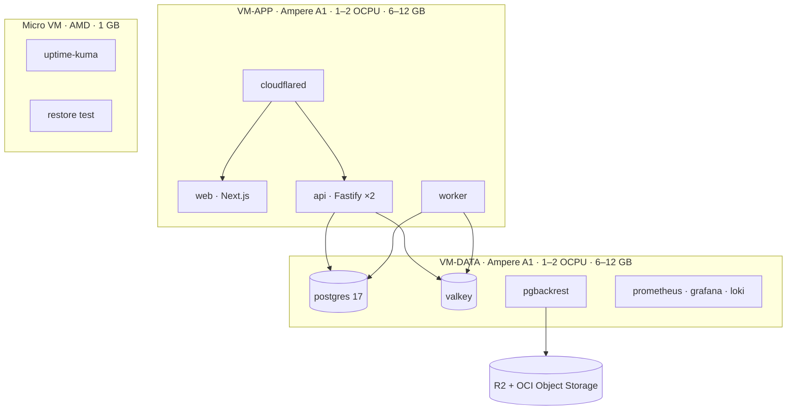
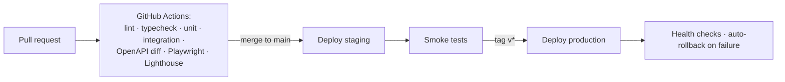

# 03 · Infrastructure

## Summary

Everything runs on free tiers: **Oracle Cloud Always Free** for servers, **Cloudflare Free** in front. The only required spend is the domain name. The stack is plain Docker, so it can move to any paid server without code changes.

Decision records: [ADR 0002](adr/0002-self-hosted-zero-cost-infra.md) (why this setup), [ADR 0004](adr/0004-hostinger-single-plan.md) (why not Hostinger Single).

## Hosting options compared

| | Oracle Always Free + Cloudflare **(chosen)** | Hostinger Single (shared) | Hostinger KVM 2 VPS | Vercel + Supabase free |
|---|---|---|---|---|
| Cost | ₹0 (domain only) | ₹2,980.80 for 48 months, then ₹289/mo | ~₹799/mo first term, higher on renewal (check current price) | ₹0, but not allowed for commercial use on Vercel Hobby |
| Runs Node.js / Fastify | Yes | **No** (Node.js only on Business and Cloud plans) | Yes | Serverless only |
| PostgreSQL | Yes (self-hosted) | **No** (MySQL only) | Yes | Yes, but pauses after 7 days idle |
| Background workers / queues | Yes | **No** | Yes | Limited |
| Docker | Yes | No | Yes | No |
| Remotion rendering | Yes | No | Yes | No (needs paid Lambda) |
| CPU / RAM | 2–4 ARM cores / 12–24 GB (see note) | Shared | 2 vCPU / 8 GB | n/a |
| Main risk | Free tier terms can change; idle VMs can be reclaimed | Cannot run this project | Costs money | Terms forbid it |

**Recommendation:** start on Oracle Always Free. If you later want paid hosting for peace of mind, a **Hostinger KVM VPS** (or any VPS with 2+ vCPU and 8 GB RAM) runs the exact same Docker stack. Do **not** buy the Single plan for this project.

> **Oracle allocation note:** Oracle's documentation has long given Always Free accounts 4 ARM cores and 24 GB RAM. Several 2026 reports say this was reduced to 2 cores and 12 GB for Always Free-only accounts. We size everything to work on **2 cores / 12 GB**. Confirm what your account actually gets when you create it.

## Domains and DNS

Buy one domain (about ₹700–1,200 per year). Point its nameservers to Cloudflare.

| Hostname | Serves | Origin |
|---|---|---|
| `example.in`, `www.example.in` | Storefront | Next.js on VM-APP via Tunnel |
| `api.example.in` | Public API | Fastify on VM-APP via Tunnel |
| `admin.example.in` | Admin SPA | Cloudflare Pages, behind Cloudflare Access |
| `media.example.in` | Images and videos | Cloudflare R2 public bucket (custom domain) |
| `staging.example.in`, `api.staging.example.in` | Staging | Same VMs, separate containers and database |

**Email on the domain, free:**
- **Receiving:** Cloudflare Email Routing forwards `support@example.in` and `orders@example.in` to the team's Gmail. Or use Zoho Mail's free plan for real mailboxes.
- **Sending transactional mail:** Brevo free (300/day) and Resend free (100/day), with SPF, DKIM and DMARC records set in Cloudflare DNS.

## Servers

- The VMs talk over Oracle's private network (VCN). Postgres and Valkey listen only on private addresses.
- **No inbound ports are open to the internet.** Public traffic arrives through Cloudflare Tunnel. Admin SSH uses Cloudflare Tunnel SSH with keys.
- On the 2-core allocation, split 1 core / 6 GB per VM. On 4 cores, 2 / 12 each.

### Containers (docker-compose)

| Service | Image | VM | Memory limit (2-core plan) |
|---|---|---|---|
| `cloudflared` | cloudflare/cloudflared | APP | 128 MB |
| `web` | built from `apps/web` | APP | 1 GB |
| `api` (×2) | built from `apps/api` | APP | 768 MB each |
| `worker` | built from `apps/api` | APP | 768 MB |
| `postgres` | postgres:17 | DATA | 3 GB (`shared_buffers` 1.5 GB) |
| `valkey` | valkey/valkey:8 | DATA | 512 MB, `maxmemory-policy noeviction` for queues |
| `pgbackrest` | pgbackrest | DATA | 256 MB |
| `prometheus`, `grafana`, `loki`, `promtail` | official | DATA | 1 GB total |

## Free services used

| Need | Service | Free limit |
|---|---|---|
| CDN, DNS, SSL, WAF, DDoS | Cloudflare | Unlimited CDN bandwidth |
| Ingress without open ports | Cloudflare Tunnel | Free |
| Admin hosting | Cloudflare Pages | Free, commercial use allowed |
| Staff gate | Cloudflare Access (Zero Trust) | 50 users |
| Object storage | Cloudflare R2 | 10 GB, no egress fees |
| Second backup location | OCI Object Storage | 20 GB |
| Push notifications | Firebase Cloud Messaging, Web Push | Free, no cap |
| Email | Brevo + Resend | ~400 emails/day combined |
| Errors | Sentry (or self-hosted GlitchTip) | 5k events/month |
| Uptime | Uptime Kuma + UptimeRobot | Free |
| CI | GitHub Actions | Free minutes |
| Sign-in | Google Identity | Free |
| Maps | Leaflet + Protomaps tiles on R2 | Free |

## Environments

| Environment | Purpose | Data | Deploys |
|---|---|---|---|
| `local` | Development on a laptop | Seed data in Docker Postgres | `pnpm dev` |
| `staging` | Test before release, Cashfree sandbox | Seed + anonymised samples | Every merge to `main` |
| `production` | Real customers, Cashfree live | Real | Tagged release (`v*`) after staging checks |

Staging and production run on the same VMs as separate compose projects with separate databases, Valkey databases, R2 buckets and secrets.

## Deploy pipeline

Deploy steps (run by GitHub Actions over Cloudflare Tunnel SSH):

1. `git pull` the tagged commit on the VM.
2. `docker compose build` (ARM images build natively on the VM; no paid registry needed).
3. Run database migrations (`pnpm db:migrate`). Migrations must be backward-compatible with the running version: expand first, contract in a later release.
4. Rolling restart: `api` containers one at a time, waiting for `/v1/health/ready`.
5. Restart `worker` (it finishes the current tick before exiting).
6. Deploy the admin SPA to Cloudflare Pages.
7. Purge Cloudflare cache for changed static assets if needed.
8. If health checks fail within 5 minutes: roll back to the previous image tag automatically.

## Infrastructure as code

| Tool | Manages |
|---|---|
| OpenTofu (`infra/tofu`) | Oracle VCN, subnets, VMs, block volumes, budgets and alerts; Cloudflare DNS, Tunnel, Access policies, R2 buckets, WAF rules, Pages projects |
| Ansible (`infra/ansible`) | OS hardening, users, SSH config, Docker, unattended security updates, fail2ban, swap, sysctl tuning |
| Docker Compose (`infra/compose`) | Containers per VM and environment |

Rebuilding the whole system on a new provider is: run OpenTofu (or create a VM by hand), run Ansible, restore the latest backup, start compose. Target: under 2 hours. Steps are in [Operations → Move to a new host](11-operations.md#move-to-a-new-host).

## Keeping the free tier safe

1. **Upgrade the Oracle account to Pay-As-You-Go** after creating the VMs. Always Free resources stay free, and Oracle's idle-reclamation rule targets Always Free-only accounts.
2. Create an **Oracle budget of ₹1 with an alert** so any accidental paid resource is noticed immediately.
3. Only create resources marked "Always Free eligible".
4. Keep the nightly backup **off Oracle** (R2) so losing the Oracle account never means losing data.

## Capacity

Sizing for 100,000 registered users; detailed reasoning in [PLAN.md §3.4](../PLAN.md).

| Measure | Estimate | Capacity on 2 cores |
|---|---|---|
| Daily active users | ~15,000 | — |
| API requests/day | ~450,000 | — |
| Peak requests/second (sales, festival days) | 75–100 | >1,000 (Fastify + Valkey cache) |
| Database size after 2 years | ~5–10 GB | 50+ GB volume |
| Media in R2 | 2–4 GB | 10 GB free |

Verified by the k6 load test in Phase 8: 500 req/s sustained, p95 under 200 ms, zero errors.

## Costs

| Item | Cost | When |
|---|---|---|
| Domain | ~₹700–1,200/year | Now |
| Hosting, database, CDN, storage, email, push, monitoring | ₹0 | — |
| Cashfree | Per-transaction fee deducted from settlements | Per payment |
| Google Play | Already paid (account exists) | — |
| Remotion | ₹0 while the company has 3 people or fewer | Re-check if team grows |
| Login | ₹0 (Google Sign-In; no SMS) | — |
| Courier | Per parcel (Shiprocket/Delhivery rates) | Per order shipped |
