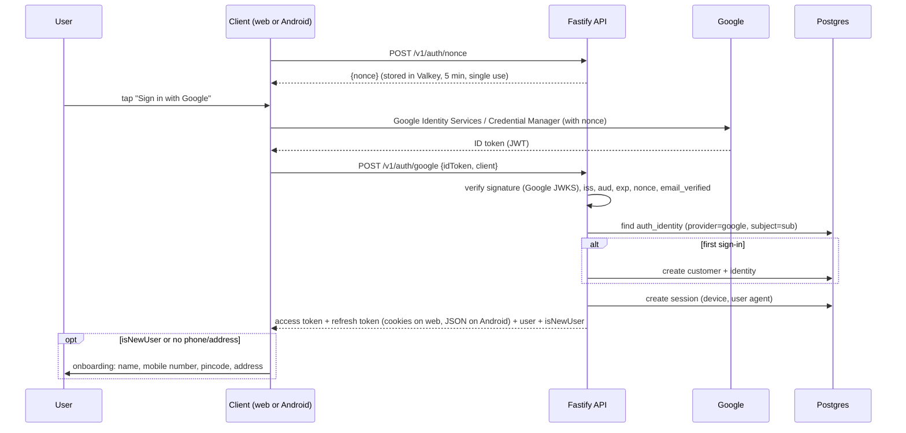
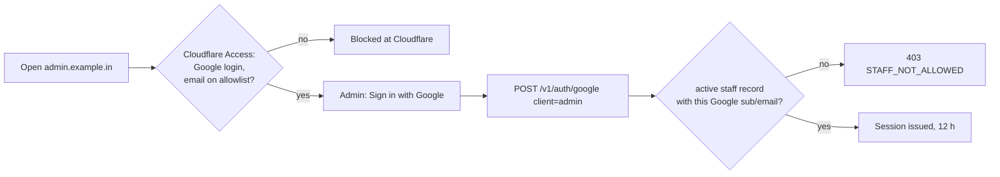

# 04 · Authentication and authorisation

**Everyone signs in with Google**, customers and staff. There is no SMS OTP and no password. Decision: [ADR 0003](adr/0003-google-only-login.md).

## Why Google only

- Free at any volume. SMS OTP in India costs money per message and needs DLT registration.
- Almost every Android phone in India already has a Google account signed in, so sign-in is one tap.
- No passwords to store, reset or leak.
- The same flow works on the website now and the Android app later.

**Trade-off:** we don't get a verified phone number. Customers enter a mobile number with each delivery address; it's validated for format and passed to the courier, but not verified by OTP. Every order is prepaid, so a wrong number can't create unpaid orders.

## Google Cloud setup (one-time)

1. Create a Google Cloud project (free), e.g. `dairy-prod`. Use the same Google account that owns the Play Console, so the Android client can be added later in the same project.
2. **OAuth consent screen** → *External*. App name, logo, support email (`support@example.in`), links to privacy policy and terms on `example.in`, authorised domain `example.in`. Scopes: `openid`, `email`, `profile` only. These are non-sensitive scopes, so no security review is needed.
3. **Credentials → OAuth client ID → Web application** ("web"):
   - Authorised JavaScript origins: `https://example.in`, `https://admin.example.in`, `https://staging.example.in`, `http://localhost:3000`, `http://localhost:5173`
   - Note the client ID → `GOOGLE_WEB_CLIENT_ID`
4. **Later, for Android:** add an *Android* OAuth client with the package name and the SHA-1 fingerprints of (a) the Play App Signing key from Play Console → *Test and release → App integrity*, (b) the upload key, (c) the debug key. The Android app passes the **web** client ID as `serverClientId`, so ID tokens it receives have the web client ID as audience and the server needs no change. See [Android integration](13-android-integration.md).

## How it works

We use the **ID token exchange** pattern. The client gets a Google ID token (a signed JWT saying "this is Google user X"), sends it to our API once, and our API issues its own session tokens. Google is used only at sign-in.

### Customer sign-in flow

### Server-side checks on the Google ID token

All must pass, otherwise `401 AUTH_INVALID_GOOGLE_TOKEN`:

| Check | Rule |
|---|---|
| Signature | Valid against Google's published keys (`google-auth-library` caches them) |
| `iss` | `accounts.google.com` or `https://accounts.google.com` |
| `aud` | Equals `GOOGLE_WEB_CLIENT_ID` |
| `exp` | In the future (allow 30 s clock skew) |
| `nonce` | Matches a nonce we issued, not yet used. Deleted on use. |
| `email_verified` | `true` |
| `sub` | Used as the stable identity key. **Never match accounts by email alone**: emails can change, `sub` doesn't. |

## Our tokens

| Token | Format | Lifetime | Stored |
|---|---|---|---|
| Access token | JWT signed with Ed25519 (`EdDSA`). Claims: `sub` (user id), `sid` (session id), `aud` (`store` or `admin`), `typ`, `role`, `client`, `iat`, `exp` | 15 minutes | Not stored server-side |
| Refresh token | 256-bit random, opaque | 30 days customers, 12 hours staff; sliding | SHA-256 hash in `sessions` table |

**Rotation:** every refresh returns a new refresh token and invalidates the old one. If an old (already used) refresh token is presented, it means it was stolen or replayed: the whole session is revoked and the user must sign in again (`401 AUTH_REFRESH_REUSED`).

**Signing keys:** Ed25519 key pair from environment variables. The public key set is published at `/v1/auth/.well-known/jwks.json` with a `kid`, so keys can be rotated: add the new key, sign with it, keep verifying the old one until old tokens expire.

## Where tokens live on each client

| Client | Access token | Refresh token | CSRF protection |
|---|---|---|---|
| Storefront (Next.js) | `httpOnly; Secure; SameSite=Lax` cookie, same origin via `/api` proxy | `httpOnly; Secure; SameSite=Strict` cookie, path `/api/v1/auth` | `SameSite` + `X-CSRF-Token` header (double-submit) on unsafe methods |
| Admin (separate subdomain) | `httpOnly; Secure; SameSite=Lax` cookie on `.example.in` | Same, path `/v1/auth` | Same, plus CORS allowlist with credentials |
| Android (later) | Memory, sent as `Authorization: Bearer …` | Encrypted on device (Android Keystore) | Not needed (no cookies) |

The API accepts either cookies or a bearer header. If both are present, the bearer header wins.

## Staff sign-in

- **Invite only.** An owner invites a Google email with a role (Admin → Settings → Team). The first successful sign-in binds the record to that Google `sub`; after that only that account can use it.
- **Optional extra layer:** Cloudflare Access (or an Nginx `allow`/`deny` IP list) in front of `admin.example.in`, so even an app bug can't expose the admin. Not enabled by default.
- **Deactivating** a member or changing their role revokes all their sessions immediately.
- **Second factor:** TOTP for Owner, Admin and Accountant is planned. Until then, require 2-step verification on those Google accounts.

## Local development without Google

With `AUTH_TEST_MODE=true` and no Cashfree keys (never in production; the API refuses to start that way), `POST /v1/dev/sign-in {email}` signs in a test customer and the storefront's sign-in page shows a "test customer" form. Staff sign-in always needs Google.

## Roles and permissions

Checked on the server for every request (`apps/api/src/lib/permissions.ts`); the admin hides what a role can't do.

| Permission | Owner | Admin | Ops manager | Warehouse | Support | Content | Accountant |
|---|---|---|---|---|---|---|---|
| `dashboard.read` | ✓ | ✓ | ✓ | ✓ | ✓ | | ✓ |
| `orders.read` | ✓ | ✓ | ✓ | ✓ | ✓ | | ✓ |
| `orders.fulfil` (pack, ship, deliver) | ✓ | ✓ | ✓ | ✓ | | | |
| `orders.refund` (cancel + refund) | ✓ | ✓ | ✓ | | ✓ | | |
| `catalog.read` | ✓ | ✓ | ✓ | ✓ | ✓ | ✓ | ✓ |
| `catalog.write` | ✓ | ✓ | ✓ | | | ✓ | |
| `pricing.write` | ✓ | ✓ | | | | | |
| `inventory.write` | ✓ | ✓ | ✓ | ✓ | | | |
| `customers.read` | ✓ | ✓ | ✓ | | ✓ | | ✓ |
| `reports.finance` | ✓ | ✓ | | | | | ✓ |
| `settings.write` (shipping zones) | ✓ | ✓ | | | | | |
| `staff.manage` | ✓ | | | | | | |
| `audit.read` | ✓ | ✓ | | | | | ✓ |

## Sessions and devices

- Each sign-in creates a session row with device name, user agent, IP (truncated), created and last-used times.
- Customers can list sessions and sign out other devices (`GET/DELETE /v1/auth/sessions`).
- Sign-out deletes the session and clears cookies.

## Account deletion

Required by Google Play for apps with accounts, and by India's DPDP Act. Available in the storefront account page and at `example.in/account/delete` (a public URL Play Console asks for).

1. `DELETE /v1/store/me` → account is marked `deletion_requested` and all sessions are revoked. Orders already shipped are still delivered.
2. After a 30-day grace period (sign in again to cancel), personal data is erased or anonymised: name, email, phone, addresses, device tokens.
3. Invoices and tax records are **kept** for the period GST law requires, with the customer reference anonymised.
