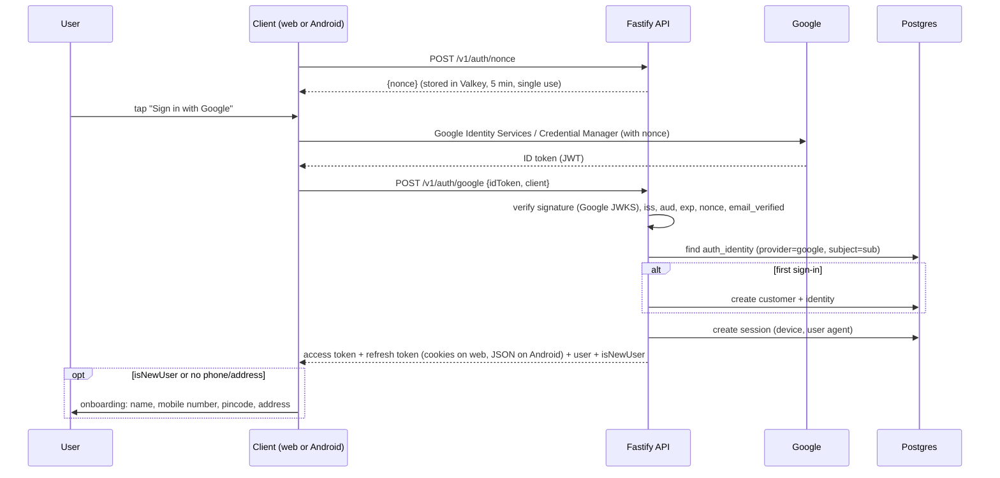
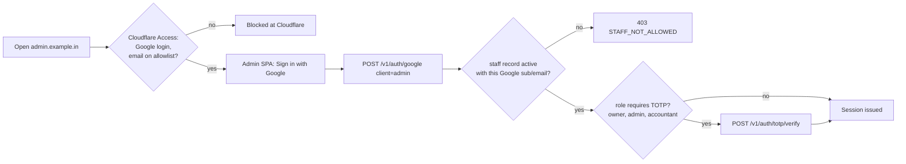

# 04 · Authentication and authorisation

**Everyone signs in with Google.** Customers, staff and delivery agents. There is no SMS OTP and no password. Decision: [ADR 0003](adr/0003-google-only-login.md).

## Why Google only

- Free at any volume. SMS OTP in India costs money per message and needs DLT registration.
- Almost every Android phone in India already has a Google account signed in, so sign-in is one tap.
- No passwords to store, reset or leak.
- The same flow works on the website now and the Android app later.

**Trade-off:** we don't get a verified phone number. Customers enter their mobile number during onboarding; it's validated for format and used by delivery agents to call, but not verified by OTP. This is acceptable because every order is prepaid from the wallet, so a wrong number can't create unpaid deliveries.

## Google Cloud setup (one-time)

1. Create a Google Cloud project (free), e.g. `dairy-prod`. Use the same Google account that owns the Play Console, so the Android client can be added later in the same project.
2. **OAuth consent screen** → *External*. App name, logo, support email (`support@example.in`), links to privacy policy and terms on `example.in`, authorised domain `example.in`. Scopes: `openid`, `email`, `profile` only. These are non-sensitive scopes, so no security review is needed.
3. **Credentials → OAuth client ID → Web application** ("web"):
   - Authorised JavaScript origins: `https://example.in`, `https://admin.example.in`, `https://agent.example.in`, `https://staging.example.in`, `http://localhost:3000`, `http://localhost:5173`, `http://localhost:5174`
   - Note the client ID → `GOOGLE_WEB_CLIENT_ID`
4. **Later, for Android:** add an *Android* OAuth client with the package name and the SHA-1 fingerprints of (a) the Play App Signing key from Play Console → *Test and release → App integrity*, (b) the upload key, (c) the debug key. The Android app passes the **web** client ID as `serverClientId`, so ID tokens it receives have the web client ID as audience and the server needs no change. See [Android integration](13-android-integration.md).

## How it works

We use the **ID token exchange** pattern. The client gets a Google ID token (a signed JWT saying "this is Google user X"), sends it to our API once, and our API issues its own session tokens. Google is used only at sign-in.

### Customer sign-in flow

### Server-side checks on the Google ID token

All must pass, otherwise `401 AUTH_INVALID_GOOGLE_TOKEN`:

| Check | Rule |
|---|---|
| Signature | Valid against Google's published keys (`google-auth-library` caches them) |
| `iss` | `accounts.google.com` or `https://accounts.google.com` |
| `aud` | Equals `GOOGLE_WEB_CLIENT_ID` |
| `exp` | In the future (allow 30 s clock skew) |
| `nonce` | Matches a nonce we issued, not yet used. Deleted on use. |
| `email_verified` | `true` |
| `sub` | Used as the stable identity key. **Never match accounts by email alone**: emails can change, `sub` doesn't. |

## Our tokens

| Token | Format | Lifetime | Stored |
|---|---|---|---|
| Access token | JWT signed with Ed25519 (`EdDSA`). Claims: `sub` (user id), `sid` (session id), `aud` (`store`, `admin` or `agent`), `role`, `iat`, `exp` | 15 minutes | Not stored server-side |
| Refresh token | 256-bit random, opaque | 30 days customers, 12 hours staff, 7 days agents; sliding | SHA-256 hash in `sessions` table |

**Rotation:** every refresh returns a new refresh token and invalidates the old one. If an old (already used) refresh token is presented, it means it was stolen or replayed: the whole session is revoked and the user must sign in again (`401 AUTH_REFRESH_REUSED`).

**Signing keys:** Ed25519 key pair from environment variables. The public key set is published at `/v1/auth/.well-known/jwks.json` with a `kid`, so keys can be rotated: add the new key, sign with it, keep verifying the old one until old tokens expire.

## Where tokens live on each client

| Client | Access token | Refresh token | CSRF protection |
|---|---|---|---|
| Storefront (Next.js) | `httpOnly; Secure; SameSite=Lax` cookie, same origin via `/api` proxy | `httpOnly; Secure; SameSite=Strict` cookie, path `/api/v1/auth` | `SameSite` + `X-CSRF-Token` header (double-submit) on unsafe methods |
| Admin, agent (separate subdomains) | `httpOnly; Secure; SameSite=Lax` cookie on `.example.in` | Same, path `/v1/auth` | Same, plus CORS allowlist with credentials |
| Android (later) | Memory, sent as `Authorization: Bearer …` | Encrypted on device (Android Keystore) | Not needed (no cookies) |

The API accepts either cookies or a bearer header. If both are present, the bearer header wins.

## Staff and agent sign-in

Staff and agents also use Google, with extra controls:

- **Staff must be invited.** An owner adds a staff member's Google email and role in admin. The first successful Google sign-in binds the staff record to that Google `sub`. After that, only that `sub` can use the record.
- **Second factor:** roles that can move money or change settings (Owner, Admin, Accountant) must also enter a 6-digit code from an authenticator app (TOTP, free). Recovery codes are shown once at setup.
- **Cloudflare Access** in front of `admin.example.in` uses Google as identity provider with the same allowlist. Even a bug in our app can't expose the admin to the public.
- **Agents** are added by Dispatch/Admin with their Google email, same binding rule. Agent sessions are limited to `/v1/agent/*`.
- **Deactivating** a staff member or agent revokes all their sessions immediately.

## Roles and permissions

Permissions are checked on the server for every request. The admin UI hides what a role can't do, but the server is the authority.

| Permission | Owner | Admin | Ops manager | Dispatch | Support | Content | Accountant | Agent |
|---|---|---|---|---|---|---|---|---|
| `catalog.read` | ✓ | ✓ | ✓ | ✓ | ✓ | ✓ | ✓ | |
| `catalog.write` | ✓ | ✓ | ✓ | | | ✓ | | |
| `pricing.write` | ✓ | ✓ | | | | | | |
| `inventory.write` | ✓ | ✓ | ✓ | ✓ | | | | |
| `dispatch.manage` | ✓ | ✓ | ✓ | ✓ | | | | |
| `customers.read` | ✓ | ✓ | ✓ | ✓ | ✓ | | ✓ | |
| `customers.write` | ✓ | ✓ | ✓ | | ✓ | | | |
| `wallet.adjust` (≤ ₹500) | ✓ | ✓ | ✓ | | ✓ | | | |
| `wallet.adjust.unlimited` | ✓ | ✓ | | | | | | |
| `orders.refund` | ✓ | ✓ | ✓ | | | | | |
| `content.write` | ✓ | ✓ | | | | ✓ | | |
| `marketing.send` | ✓ | ✓ | | | | ✓ | | |
| `reports.finance` | ✓ | ✓ | | | | | ✓ | |
| `settings.write` | ✓ | ✓ | | | | | | |
| `staff.manage` | ✓ | | | | | | | |
| `audit.read` | ✓ | ✓ | | | | | ✓ | |
| `agent.deliver` | | | | | | | | ✓ |

Roles map to permission sets in `packages/auth/permissions.ts`. A route declares the permission it needs: `{ config: { permission: 'orders.refund' } }`.

## Sessions and devices

- Each sign-in creates a session row with device name, user agent, IP (truncated), created and last-used times.
- Customers can list sessions and sign out other devices (`GET/DELETE /v1/auth/sessions`).
- Sign-out deletes the session and clears cookies.

## Account deletion

Required by Google Play for apps with accounts, and by India's DPDP Act. Available in the storefront account page and at `example.in/account/delete` (a public URL Play Console asks for).

1. `DELETE /v1/store/me` → account is marked `deletion_requested`, all sessions revoked, subscriptions cancelled.
2. Any remaining wallet balance is refunded to the original payment method (or the customer is contacted if that's not possible).
3. After a 30-day grace period (sign in again to cancel), personal data is erased or anonymised: name, email, phone, addresses, device tokens.
4. Invoices and tax records are **kept** for the period GST law requires, with the customer reference anonymised.
