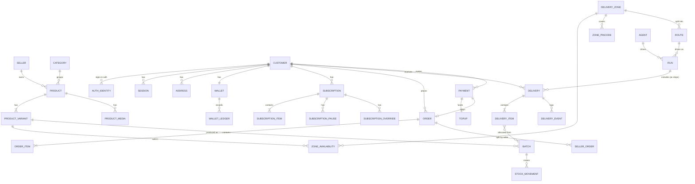

# 05 · Data model

PostgreSQL 17 with PostGIS and `pg_trgm`. Schema defined in Drizzle (`packages/db/schema`), migrations as SQL files committed to the repo.

## Conventions

| Rule | Detail |
|---|---|
| Primary keys | `id text` with a type prefix and a UUIDv7 body, e.g. `cus_01JD3K…`. Sortable by creation time. |
| Money | `bigint` paise, column suffix `_paise` (`price_paise`). Never `numeric` for app money, never floats. |
| Quantities | `integer` units of the variant (one 500 ml pouch = 1). Volume and weight are variant attributes. |
| Timestamps | `timestamptz` in UTC: `created_at`, `updated_at` on every table. |
| Business dates | `date`, interpreted in `Asia/Kolkata`: `delivery_date`, `starts_on`, `ends_on`. |
| Soft delete | Only for catalog and staff (`archived_at`). Financial rows are never deleted or updated in place. |
| Append-only | `wallet_ledger`, `stock_movements`, `bottle_ledger`, `delivery_events`, `order_events`, `audit_log`, `webhook_events`. No `UPDATE` or `DELETE` grants for the app user on these. |
| Seller scope | `seller_id` on every seller-owned table (catalog, stock, orders, deliveries, routes). One seller exists at launch. |
| Enums | Postgres `text` with `CHECK` constraints (easier to extend than native enums). |
| Row-level security | Enabled on seller-scoped tables as defence in depth. The API sets `app.seller_id` per transaction. |

## Entity relationship overview

## Tables

Key columns only. Every table also has `created_at` and `updated_at`.

### Sellers and staff

| Table | Key columns |
|---|---|
| `sellers` | `id`, `name`, `legal_name`, `gstin`, `fssai_number`, `status` (`active`/`suspended`), `settings jsonb` |
| `staff` | `id`, `seller_id` (null = platform staff), `email`, `google_sub` (bound on first sign-in), `name`, `role`, `totp_secret_enc`, `status`, `last_sign_in_at` |
| `agents` | `id`, `seller_id`, `email`, `google_sub`, `name`, `phone`, `status` |

### Customers and auth

| Table | Key columns |
|---|---|
| `customers` | `id`, `name`, `email`, `phone` (E.164, unverified), `language` (`en`/`hi`), `status` (`active`/`deletion_requested`/`deleted`), `referral_code`, `referred_by` |
| `auth_identities` | `id`, `user_type` (`customer`/`staff`/`agent`), `user_id`, `provider` (`google`), `subject` (Google `sub`), `email`. Unique (`provider`, `subject`, `user_type`). |
| `sessions` | `id`, `user_type`, `user_id`, `refresh_token_hash`, `previous_token_hash`, `client` (`web`/`admin`/`agent`/`android`), `device_name`, `user_agent`, `ip_prefix`, `expires_at`, `last_used_at`, `revoked_at` |
| `addresses` | `id`, `customer_id`, `label`, `line1`, `line2`, `landmark`, `society`, `city`, `state`, `pincode`, `location geography(Point)`, `zone_id`, `delivery_instructions`, `is_default` |
| `devices` | `id`, `customer_id`, `platform` (`web`/`android`), `push_token`, `app_version`, `last_seen_at` |

### Catalog

| Table | Key columns |
|---|---|
| `categories` | `id`, `parent_id`, `slug`, `name_en`, `name_hi`, `sort` |
| `products` | `id`, `seller_id`, `category_id`, `slug`, `name_en`, `name_hi`, `description_en`, `description_hi`, `attributes jsonb` (animal, fat %, SNF, pasteurised, A2, source farm), `is_veg`, `status` (`draft`/`active`/`archived`), `search tsvector` |
| `product_variants` | `id`, `product_id`, `seller_id`, `sku`, `pack_size` (`500ml`), `unit` (`ml`/`g`/`pcs`), `unit_quantity`, `price_paise` (GST-inclusive), `mrp_paise`, `subscription_price_paise`, `hsn_code`, `gst_rate_bps` (500 = 5%), `shelf_life_days`, `storage` (`chilled`/`frozen`/`ambient`), `packaging` (`pouch`/`bottle`/`tub`/`box`), `bottle_deposit_paise`, `subscribable`, `status` |
| `product_media` | `id`, `product_id`, `kind` (`image`/`video`), `r2_key`, `sizes jsonb`, `alt_en`, `alt_hi`, `sort`, `video_render_id` |
| `zone_availability` | `variant_id`, `zone_id`, `available`, `max_per_day` |

### Zones and delivery setup

| Table | Key columns |
|---|---|
| `delivery_zones` | `id`, `seller_id`, `name`, `area geography(MultiPolygon)`, `status` |
| `zone_pincodes` | `zone_id`, `pincode` |
| `delivery_slots` | `id`, `seller_id`, `code` (`morning`/`evening`), `starts_at time`, `ends_at time`, `cutoff_offset_minutes` (e.g. −480 = 22:00 previous day for a 06:00 slot start), `days_of_week int[]`, `active` |
| `holidays` | `seller_id`, `date`, `slot_id` (null = all), `reason` — no deliveries generated |
| `routes` | `id`, `zone_id`, `name`, `default_agent_id` |
| `route_stops` | `route_id`, `address_id`, `sequence` |

### Subscriptions

| Table | Key columns |
|---|---|
| `subscriptions` | `id`, `customer_id`, `seller_id`, `address_id`, `slot_id`, `pattern` (`daily`/`alternate`/`weekdays`), `anchor_date` (for alternate), `starts_on`, `ends_on`, `status` (`active`/`cancelled`), `cancel_reason` |
| `subscription_items` | `id`, `subscription_id`, `variant_id`, `quantity`, `weekday_quantities int[7]` (Mon..Sun; used when pattern is `weekdays`) |
| `subscription_pauses` | `id`, `subscription_id`, `starts_on`, `ends_on`, `created_by` |
| `subscription_overrides` | `subscription_id`, `date`, `items jsonb` (`[{variantId, quantity}]`; empty array = skip that day). Unique (`subscription_id`, `date`). |

### Orders

| Table | Key columns |
|---|---|
| `carts` | `id`, `customer_id`, `items jsonb`, `coupon_code`, `expires_at` |
| `orders` | `id`, `number` (human: `D-260412-0042`), `customer_id`, `address_id`, `delivery_date`, `slot_id`, `status`, `payment_method` (`wallet`/`online`), `subtotal_paise`, `discount_paise`, `deposit_paise`, `total_paise`, `tax_paise`, `coupon_id`, `idempotency_key` |
| `order_items` | `id`, `order_id`, `variant_id`, `seller_id`, `name_snapshot`, `sku_snapshot`, `unit_price_paise`, `quantity`, `gst_rate_bps`, `hsn_code`, `line_total_paise` |
| `seller_orders` | `id`, `order_id`, `seller_id`, `status`, `subtotal_paise` — the fulfilment unit; exactly one per order at launch |
| `order_events` | `order_id`, `type`, `from_status`, `to_status`, `actor_type`, `actor_id`, `data jsonb`, `at` |
| `refunds` | `id`, `order_id`, `delivery_id`, `amount_paise`, `destination` (`wallet`/`source`), `reason`, `cashfree_refund_id`, `status` |
| `invoices` | `id`, `number` (`INV/26-27/000123`, ≤16 chars, sequential per financial year), `seller_id`, `customer_id`, `delivery_id`/`order_id`, `kind` (`tax_invoice`/`bill_of_supply`/`invoice_cum_bos`), `lines jsonb`, `taxable_paise`, `cgst_paise`, `sgst_paise`, `igst_paise`, `total_paise`, `pdf_r2_key`, `issued_at` |

### Deliveries

| Table | Key columns |
|---|---|
| `cutoff_runs` | `id`, `seller_id`, `delivery_date`, `slot_id`, `status` (`running`/`completed`/`failed`), `started_at`, `finished_at`, `stats jsonb` |
| `runs` | `id`, `route_id`, `agent_id`, `delivery_date`, `slot_id`, `status` (`planned`/`started`/`completed`) |
| `deliveries` | `id`, `customer_id`, `seller_id`, `address_id`, `delivery_date`, `slot_id`, `run_id`, `stop_sequence`, `status`, `charge_paise`, `charged_at`. **Unique (`customer_id`, `address_id`, `delivery_date`, `slot_id`).** |
| `delivery_items` | `id`, `delivery_id`, `variant_id`, `quantity`, `unit_price_paise`, `source` (`subscription`/`order`), `subscription_id`, `order_id` |
| `delivery_allocations` | `delivery_item_id`, `batch_id`, `quantity` |
| `delivery_events` | `id`, `delivery_id`, `type`, `actor_type`, `actor_id`, `client_event_id` (unique, for offline sync), `data jsonb` (bottles, photo key, reason), `occurred_at`, `received_at` |

### Wallet and payments

| Table | Key columns |
|---|---|
| `wallets` | `id`, `customer_id` (unique), `balance_paise` (cache of ledger sum, updated in the same transaction), `overdraft_limit_paise`, `low_balance_threshold_paise` |
| `wallet_ledger` | `id`, `wallet_id`, `entry_group_id`, `account` (`customer`, `cashfree_clearing`, `revenue`, `promotions`, `refunds`, `adjustments`), `amount_paise` (+ credit to customer, − debit), `kind` (`topup`/`delivery_charge`/`refund`/`promo`/`adjustment`/`reversal`/`deposit`), `reference_type`, `reference_id`, `memo`, `created_by`. **Unique (`kind`, `reference_type`, `reference_id`)** prevents double posting. Each `entry_group_id` sums to zero across accounts. |
| `topups` | `id`, `wallet_id`, `amount_paise`, `status` (`pending`/`paid`/`failed`/`expired`), `payment_id`, `source` (`manual`/`autopay`), `idempotency_key` |
| `autopay_mandates` | `id`, `customer_id`, `cashfree_subscription_id`, `status`, `threshold_paise`, `recharge_paise`, `max_paise`, `authorised_at`, `cancelled_at` |
| `payments` | `id`, `customer_id`, `purpose` (`topup`/`order`), `amount_paise`, `cashfree_order_id`, `cashfree_payment_id`, `payment_session_id`, `method`, `status` (`created`/`pending`/`success`/`failed`/`user_dropped`/`refunded`), `raw jsonb` |
| `webhook_events` | `id`, `provider`, `event_id` (unique), `type`, `signature_valid`, `payload jsonb`, `processed_at`, `error` |
| `settlements` | `id`, `cashfree_settlement_id`, `amount_paise`, `fees_paise`, `tax_on_fees_paise`, `settled_on`, `reconciled` |

### Inventory

| Table | Key columns |
|---|---|
| `batches` | `id`, `variant_id`, `seller_id`, `code`, `manufactured_on`, `expires_on`, `quantity_produced`, `status` |
| `stock_levels` | `batch_id`, `on_hand`, `reserved` |
| `stock_movements` | `id`, `batch_id`, `kind` (`produced`/`reserved`/`released`/`dispatched`/`returned`/`wasted`/`adjusted`), `quantity` (signed), `reference_type`, `reference_id`, `reason`, `created_by` |
| `production_plans` | `id`, `seller_id`, `delivery_date`, `slot_id`, `lines jsonb` (`variantId`, `required`, `buffer`, `inStock`, `toProduce`), `generated_at` |

### Bottles

| Table | Key columns |
|---|---|
| `bottle_ledger` | `id`, `customer_id`, `bottle_type`, `quantity` (+ given, − returned), `deposit_paise`, `delivery_id`, `created_by` |

### Content, marketing, video

| Table | Key columns |
|---|---|
| `pages` | `id`, `slug`, `title_en`, `title_hi`, `body_en`, `body_hi`, `status` |
| `home_blocks` | `id`, `kind`, `data jsonb`, `sort`, `active_from`, `active_to` |
| `banners` | `id`, `placement`, `image_key`, `link`, `active_from`, `active_to` |
| `coupons` | `id`, `code`, `kind` (`percent`/`fixed`/`free_item`/`first_order`), `value`, `conditions jsonb`, `max_uses`, `max_uses_per_customer`, `starts_at`, `ends_at` |
| `coupon_redemptions` | `coupon_id`, `customer_id`, `order_id`, `amount_paise` |
| `referrals` | `referrer_id`, `referee_id`, `status`, `reward_paise`, `rewarded_at` |
| `notifications` | `id`, `customer_id`, `channel` (`push`/`email`/`in_app`), `template`, `data jsonb`, `status`, `sent_at`, `read_at` |
| `video_templates` | `id`, `code`, `version`, `props_schema jsonb`, `formats text[]` |
| `video_renders` | `id`, `template_id`, `props jsonb`, `props_hash`, `format`, `status`, `output_r2_key`, `error`, `requested_by` |

### Platform

| Table | Key columns |
|---|---|
| `settings` | `seller_id`, `key`, `value jsonb` |
| `audit_log` | `id`, `actor_type`, `actor_id`, `action`, `entity_type`, `entity_id`, `before jsonb`, `after jsonb`, `ip_prefix`, `request_id`, `at` |
| `idempotency_keys` | `key`, `user_id`, `route`, `request_hash`, `response_status`, `response_body jsonb`, `expires_at` |
| `api_keys` | `id`, `seller_id`, `name`, `key_hash`, `scopes text[]`, `last_used_at`, `revoked_at` |

## Important indexes

| Index | Why |
|---|---|
| `deliveries (delivery_date, slot_id, run_id, stop_sequence)` | Dispatch board, agent run |
| `deliveries (customer_id, delivery_date)` | Customer calendar |
| `subscriptions (status, slot_id) WHERE status = 'active'` | Cutoff expansion |
| `subscription_pauses (subscription_id, starts_on, ends_on)` | Pause lookup at cutoff |
| `wallet_ledger (wallet_id, id DESC)` | Ledger pagination |
| `products USING gin (search)`, `products USING gin (name_en gin_trgm_ops)` | Search, typo tolerance |
| `delivery_zones USING gist (area)` | Point-in-zone lookup |
| `batches (variant_id, expires_on) WHERE status = 'active'` | FEFO allocation |
| `payments (cashfree_order_id)` unique | Webhook lookup |

## Database users

| User | Rights |
|---|---|
| `app` | `SELECT, INSERT, UPDATE, DELETE` on normal tables; `SELECT, INSERT` only on append-only tables |
| `migrator` | DDL; used only by the migration step |
| `readonly` | `SELECT` for reports and Grafana |
| `backup` | Replication rights for pgBackRest |
