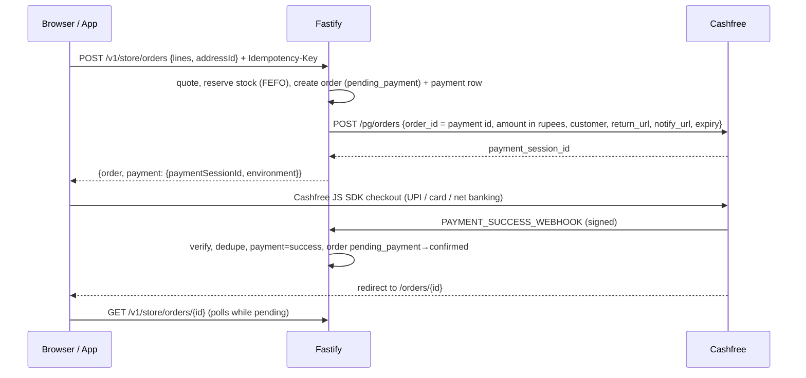

# 07 · Payments with Cashfree

All payments are in INR through **Cashfree Payment Gateway**, behind a `PaymentProvider` interface (`apps/api/src/services/payments.ts`). In development, a **mock provider** with the same interface stands in, so the whole purchase flow works without keys.

| Environment | Provider | When |
|---|---|---|
| local / test | `mock` | `CASHFREE_APP_ID` not set (refused in production) |
| staging | Cashfree sandbox | `CASHFREE_ENV=sandbox` + test keys |
| production | Cashfree production | `CASHFREE_ENV=production` + live keys |

Keys never reach the browser or the app; clients only see a `payment_session_id`.

## Flow

**The browser redirect never marks anything paid.** Only a verified webhook, a server-side status check, or (development only) the mock simulate endpoint does.

## Details

- **Amounts:** stored in paise; converted to Cashfree's rupee decimals by one tested helper (`paiseToRupeeString`).
- **Idempotency:** our payment ID is the Cashfree `order_id` and is sent as `x-idempotency-key`; refunds use our refund ID.
- **Webhook verification:** `base64(HMAC-SHA256(secret, x-webhook-timestamp + rawBody))`, constant-time compare, timestamp within 5 minutes, raw body captured before JSON parsing. Events are stored once (`webhook_events`) before processing; duplicates return `200 {status: duplicate}`; processing errors return `500` so Cashfree retries. Cashfree's docs show the signed string in two slightly different forms; **confirm with a real sandbox webhook before go-live** (the verifier has tests with locally signed payloads).
- **Missed webhooks:** when an order's payment window passes, the worker calls `GET /pg/orders/{id}` (and `/payments`) before closing it, so a payment whose webhook never arrived still confirms the order.
- **Paid after close:** money for an already-closed order is refunded automatically.
- **Refunds:** `POST /pg/orders/{id}/refunds` with our refund ID; recorded in `refunds`. Triggered by customer cancel (before packing), staff cancel (before shipping), or a late payment.
- **Retry:** `POST /v1/store/orders/{id}/pay` creates a new payment attempt for an unpaid order inside its window.

## Storefront

`startPayment()` in `apps/web/src/components/CheckoutView.tsx`: with the mock provider it routes to `/checkout/pay/{paymentId}` (a clearly labelled test page); with Cashfree it loads `https://sdk.cashfree.com/js/v3/cashfree.js` and calls `checkout({ paymentSessionId, redirectTarget: '_self' })`. Cashfree redirects back to `/orders/{id}`, which polls until the webhook lands.

## Testing

- Integration tests run the full Cashfree path with a stubbed HTTP client: order creation payload (amount in rupees, phone without +91), signed webhook accepted once, duplicate ignored, bad signature and stale timestamp rejected.
- Mock-provider tests cover pay, cancel-with-refund, and expiry releasing stock.
- Before launch: a real sandbox payment with Cashfree test UPI/cards, with the webhook delivered to staging.

## Later

UPI Autopay (recurring orders), Easy Split payouts when multi-vendor is switched on, settlement reconciliation report in admin.
