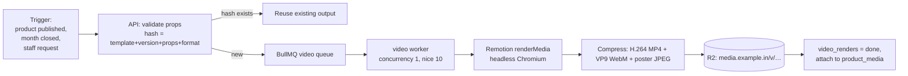

# 09 · Video with Remotion

Remotion renders React components into MP4/WebM. We use it to generate videos from store data, rendered on **our own server** (no Remotion Lambda, no AWS bill).

## Licence

Remotion is free for individuals and for-profit companies with **up to 3 people** (combined headcount if teams collaborate). From 4 people a paid Company License is required. If the team grows past 3, we switch the renderer to **Revideo** (MIT licence, free at any size). All rendering goes through a `VideoRenderer` interface in `apps/video/src/renderer.ts`, and templates are plain React with typed props, so the switch is contained to the renderer adapter and template primitives. **Re-check headcount every quarter.**

## Templates

| Code | Output | Formats | Data |
|---|---|---|---|
| `product-reel` | 6–10 s product clip: farm → pack → product facts → price | 4:5, 9:16 | Product, variants, media, attributes |
| `monthly-recap` | Customer's "your month in milk": deliveries, litres, pauses, savings | 9:16 | Statement for one customer and month |
| `festival-campaign` | Campaign clip for Diwali, Janmashtami, Holi etc. | 9:16, 1:1, 16:9 | Staff-chosen products, headline, offer, dates |
| `delivery-receipt` | Animated receipt printing line by line | 4:5 | One delivery or order |
| `owner-weekly` | Owner's weekly recap: volumes, revenue, churn | 16:9 | Admin dashboard metrics |

Each template has:

- `props.schema.ts`: a TypeBox schema. The admin Campaign Studio form is generated from it, and the API validates render requests against it.
- `Composition.tsx`: the React composition, using tokens and fonts from `packages/ui` so videos match the site.
- `version`: bumped whenever visuals change; part of the cache key.
- Stills test: CI renders frame 0 and a middle frame as PNGs to catch layout breaks.

## Pipeline

## Resource rules

- Concurrency 1, CPU-limited container, OS niceness 10, so renders never slow the API.
- Bulk jobs (monthly recaps for all customers) run between **00:30 and 04:00 IST**, outside the cutoff window and before morning deliveries start. Only customers who opened a statement in the last 60 days get a recap, to save compute.
- Daily render quota in settings (default 200). Above it, jobs wait until the next night.
- Output targets: 1080px on the long side, ~1–2 MB per 8 s clip.
- Failed renders retry twice, then fall back to a static image and alert content staff.

## Where videos appear

| Place | How |
|---|---|
| Product page | `<video>` with poster, `preload="none"`, plays when scrolled into view; no autoplay on cellular in Lite mode |
| Monthly statement | Recap video with share button (Web Share API → WhatsApp) |
| Order confirmation | Receipt animation, pre-rendered |
| Admin → Campaign Studio | Live preview with `@remotion/player` (admin only, lazy-loaded), then export |
| Admin dashboard | Weekly owner video |

The storefront **never** loads the Remotion player or runtime; it only serves rendered files.

## Accessibility

- No sound by default; captions burned in for any spoken words.
- Every video has a text equivalent next to it (product facts, statement numbers).
- No flashing content (stays below 3 flashes per second).
