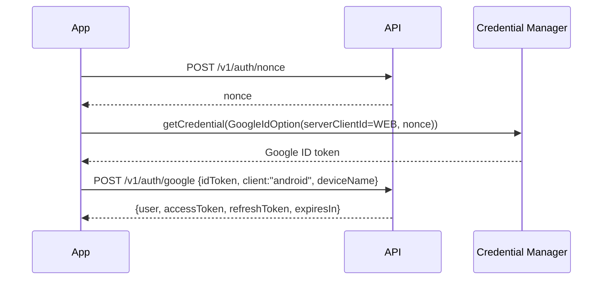

# 13 · Android integration (later phase)

The Android app is planned after the website launches. The Google Play Console account already exists. **No backend changes are needed** to build it: the API, auth and payments are designed for it now. This guide is for whoever builds the app.

## Technology choice

| Option | Pros | Cons |
|---|---|---|
| **React Native (Expo)** — recommended for this team | Same TypeScript as the web team; reuses the generated API client, types and `packages/core` helpers (dates, money); one codebase could later serve iOS | Slightly heavier than native on very low-end phones |
| Kotlin + Jetpack Compose | Best performance and smallest app on low-end devices; first-class Credential Manager and FCM | Separate language and codebase; client generated from OpenAPI |

Either way, the app talks only to the public `/v1` API.

## Sign in with Google

1. **Google Cloud project:** the same project as the website (see [Authentication → Google Cloud setup](04-authentication.md#google-cloud-setup-one-time)).
2. **Create an Android OAuth client** with:
   - Package name, e.g. `in.example.dairy`
   - SHA-1 of the **Play App Signing** key (Play Console → *Test and release → App integrity → App signing*)
   - SHA-1 of the upload key and of the debug keystore (for development)
3. In the app, request a Google ID token with **Credential Manager**:
   - Kotlin: `GetGoogleIdOption.Builder().setServerClientId(WEB_CLIENT_ID).setNonce(nonce).setFilterByAuthorizedAccounts(false)`; fall back to `GetSignInWithGoogleOption` for the button.
   - Expo: a maintained Google Sign-In module that returns an ID token for the **web client ID**.
4. **Use the web client ID as `serverClientId`.** The resulting ID token's audience is the web client ID, which the server already accepts.
5. Flow:



## Token handling

- Keep the **access token in memory**. Send `Authorization: Bearer <token>` and `X-Client: android/<versionName> (<versionCode>)`.
- Store the **refresh token encrypted** (Android Keystore-backed encryption, e.g. Tink with DataStore). Never in plain SharedPreferences or logs.
- On `401 AUTH_TOKEN_EXPIRED`: call `POST /v1/auth/refresh` with the refresh token **once** (serialise concurrent refreshes with a mutex; OkHttp `Authenticator` works well), save the new refresh token, retry the request.
- On `401 AUTH_REFRESH_INVALID` or `AUTH_REFRESH_REUSED`: clear tokens and show sign-in.
- Sign out: `POST /v1/auth/logout`, clear tokens, also call Credential Manager `clearCredentialState()`.

## App start sequence

1. `GET /v1/app-config` (with `If-None-Match`).
2. If `versionCode < minVersions.android` → blocking "Update the app" screen (Play Store link, or the in-app updates API).
3. If signed in → load profile, wallet and calendar in parallel.
4. Register or refresh the FCM token: `POST /v1/store/me/devices`.

Any endpoint can return `426 APP_VERSION_UNSUPPORTED`; handle it globally with the same update screen.

## Payments (Cashfree Android SDK)

1. `POST /v1/store/wallet/topups` (or `/orders` with `paymentMethod: online`) with an `Idempotency-Key` → receive `paymentSessionId`.
2. Launch the Cashfree Android SDK checkout with the `paymentSessionId` and the order ID. Prefer UPI intent flow (opens the customer's UPI app).
3. When the SDK returns (success, failure or cancel), **don't trust it**: poll `GET /v1/store/wallet/topups/{id}` until `paid`, `failed` or `expired` (every 2 s, up to 60 s), then show the result.
4. If the app is killed mid-payment, the server still completes the top-up from the webhook; the wallet screen shows the new balance on next open.

## Push notifications

- Firebase project linked to the same Google Cloud project; add the app, download `google-services.json`.
- On token refresh, `POST /v1/store/me/devices {platform: "android", pushToken, appVersion}`.
- Notification payloads include `type` and a `link` (e.g. `example://calendar/2026-12-02`); route with deep links.
- Ask for the Android 13+ notification permission after the first subscription, not at first launch.

## Deep links

Android App Links for `https://example.in/...` paths so links in emails and WhatsApp open the app:

| Path | Screen |
|---|---|
| `/calendar/{date}` | Calendar on that date |
| `/wallet` | Wallet |
| `/p/{slug}` | Product |
| `/orders/{id}` | Order |
| `/statements/{month}` | Statement |

`https://example.in/.well-known/assetlinks.json` is served by the storefront with the Play App Signing SHA-256.

## Offline and slow networks

- Cache the catalog with ETags; show the cached calendar and wallet when offline, with a clear "offline" banner.
- Writes (calendar changes, top-ups) need network; show a retry, and reuse the same `Idempotency-Key` on retry.
- Keep the APK small: target < 15 MB download; use WebP/AVIF images from the API's sized variants.

## Play Store requirements checklist

- [ ] Account deletion in-app (`DELETE /v1/store/me`) and the public web URL `https://example.in/account/delete`
- [ ] Privacy policy URL
- [ ] Data safety form: collects name, email, phone, address, approximate/precise location (address pin), purchase history; shared with payment processor (Cashfree); encrypted in transit; deletion available
- [ ] Target the current required API level
- [ ] Content rating questionnaire
- [ ] Payment: Cashfree for physical goods is allowed (Google Play Billing is only required for digital goods)
- [ ] Closed testing track with real testers before production (required for new personal developer accounts)

## Generating the API client

```bash
# Kotlin (Retrofit)
npx @openapitools/openapi-generator-cli generate \
  -i docs/api/openapi.yaml -g kotlin --library jvm-retrofit2 \
  -o android/api-client --additional-properties=serializationLibrary=kotlinx_serialization

# Expo / React Native: use packages/contracts (openapi-typescript + openapi-fetch)
```

Regenerate whenever `docs/api/openapi.yaml` changes. The API never breaks `/v1`, so older app versions keep working.
